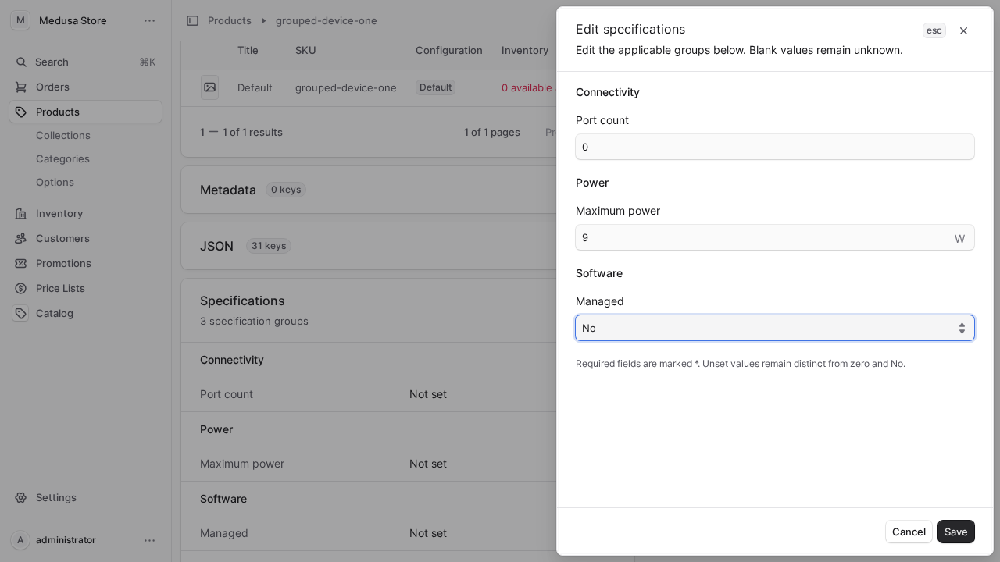

# Medusa Product Attributes

[](https://github.com/abhi1693/medusa-product-attributes/actions/workflows/ci.yml)
[](https://docs.medusajs.com/)
[](LICENSE)
[](https://github.com/sponsors/abhi1693)

Typed product specifications composed from reusable groups for Medusa v2. Attach several groups to a product and edit their labelled fields with normal Admin controls.

The plugin owns template definitions and immutable specification revisions linked to native Medusa Products and Variants. Your application supplies its categories, brands and authorization policy. Native metadata can be an optional derived export.

Medusa's built-in Attributes fields continue to hold dimensions, weight and customs information. This plugin adds merchant-defined technical specifications such as interface types, port counts and power budgets, with reusable templates and typed validation. Native product options continue to define purchasable variant choices.

Development preview: the first release has not been published to npm. Use a reviewed source revision or built archive for evaluation. The [storage design](docs/storage-decision.md) preserves specification edits independently of native Product rollback.

## Capabilities

| Capability                 | Behavior                                                                                                                                                          |
| -------------------------- | ----------------------------------------------------------------------------------------------------------------------------------------------------------------- |
| Typed specifications       | Text, numbers with a declared unit and bounds, boolean values, single choice and multiple choices.                                                                |
| Product and variant fields | Templates distinguish shared product data from sellable-configuration data.                                                                                       |
| Native Admin editing       | Settings pages manage templates; product and variant detail widgets expose specification editing.                                                                 |
| Stable schemas             | Templates have stable keys and immutable versions. Each assigned group pins its definition revision. Definition edits do not silently reinterpret product values. |
| Incremental authoring      | Drafts can be incomplete. Publication validation reports missing or invalid required specifications.                                                              |
| Application configuration  | Declare templates in code or create them in Admin. Merchant-specific definitions remain outside the plugin.                                                       |
| Extensible authorization   | Use Medusa authentication with an application-supplied authorization callback. A particular RBAC package is not required.                                         |
| Storefront contract        | Normalized typed values and search/filter/comparison flags support downstream integrations. Storefront UI and search indexing are separate work.                  |

The [storefront filtering contract](docs/storefront-filtering.md) explains stable choice codes, numeric units, schema-version interpretation and variant grouping, together with the backend query/index work required before exposing filters or facet counts.

## Admin preview

Manage reusable schemas from **Settings → Specification groups**, including their current version and source.

Each product can have several groups, such as Connectivity, Power and Software. A group is the reusable template; there is no second group/template hierarchy. Manage applicability on the product and edit numeric, choice and Yes/No fields in a grouped drawer. Blank values remain distinct from zero and No.

Native product/variant fields remain authoritative for physical and customs attributes. The application must declare its measurement-unit convention and map only verified facts; device and packed shipping measurements are different.



## Development

Requires Docker Compose. Node, npm, Medusa and browser tools run inside containers. The validated dependency baseline is Medusa **2.22.2**, UI **4.2.9**, Vite **7.3.7**, Node **24** and npm **11.19.0**.

Run commands from the repository root:

```sh
docker compose --profile tools run --rm --build --no-deps tooling npm run pack:local
```

The archive is generated at `artifacts/abhi1693-medusa-product-attributes-0.0.1.tgz` inside the shared development volume. The included isolated Medusa host consumes this built archive rather than a source link. See [development setup](docs/development.md) for administrator bootstrap, migration ordering and CI commands.

Normal Compose startup does not run unit, integration or browser tests. Select `compose.ci.yaml` explicitly when reproducing CI.

## Application configuration

Install the reviewed built archive in your Medusa application and register the plugin:

```ts
import { defineConfig } from "@medusajs/framework/utils"
import type { ProductAttributesOptions } from "@abhi1693/medusa-product-attributes/types"

const attributes: ProductAttributesOptions = {
  templates: [
    {
      key: "equipment",
      name: "Equipment specifications",
      fields: [
        {
          key: "capacity",
          label: "Capacity",
          type: "number",
          scope: "product",
          unit: "Gbps",
          min: 0,
          required: true,
          searchable: false,
          filterable: true,
          comparable: true,
        },
      ],
    },
  ],
}

module.exports = defineConfig({
  // ...projectConfig...
  plugins: [
    { resolve: "@abhi1693/medusa-product-attributes", options: attributes },
  ],
})
```

Run native migrations before starting application processes. To synchronize configured templates, add a CLI wrapper:

```ts
// src/scripts/sync-product-attributes.ts
export { default } from "@abhi1693/medusa-product-attributes/sync-templates"
```

Include this CLI command after migrations in your application's migration service. The public module service also exposes `synchronize()`. Synchronization preserves stable keys and existing assignments; changed definitions create immutable revisions. Do not register a second copy of the module.

An application's root dependency overrides are not inherited from this plugin. Review [dependency compatibility](docs/dependency-compatibility.md) when using the pinned Medusa baseline.

## Product group contract

Use the same reusable definition on multiple products. Product and variant values remain in one immutable product snapshot, with separate scopes and no implicit inheritance.

```ts
const assigned = await client.assignGroups(productId, {
  version: current.version,
  groups: [
    { template_id: connectivity.id, template_version: connectivity.version },
    { template_id: power.id, template_version: power.version },
  ],
})
await client.saveValues(productId, {
  version: assigned.version,
  values: { port_count: 8, max_power_w: 9 },
})
```

The Admin endpoint is `POST /admin/product-attributes/products/:id/groups`. Membership is a complete ordered list, limited to 30 groups. Repeated group IDs and duplicate field keys across groups are rejected. Each fact has one owning definition; do not create editable copies of native fields. Removing a group removes its fields from the current snapshot, preserving immutable history and unrelated values.

The normalized product and Store responses expose `groups`, typed product `values` and current native `variants`. No serialized vendor sections or raw audit graph is exposed. The previous singular assignment endpoint/shape is removed. The schema migration can carry an earlier single assignment into a one-group snapshot without changing its values. It never resets product data. Application-specific cleanup/backfill is a separate explicit operation.

## Data and authorization boundaries

Assign several groups explicitly to a product. Category associations recommend groups; they do not silently change membership. Schema changes create a new version. Archiving prevents new assignments while preserving existing versions and values.

The Store endpoint serves a complete current specification revision only for a native published product in the publishable key's sales channel. Native Product rollback cannot overwrite the module's specification values. Incomplete or ineligible records are withheld; the endpoint does not fall back to an older revision. The search/filter/comparison flags describe intended presentation and indexing; they are not confidentiality controls. Do not place private operational notes or secrets in storefront specification fields or metadata exports.

Custom Admin APIs require a native Medusa user. Without an authorization callback, authenticated administrators can manage attributes. Supply `authorize(request, context)` to enforce fine-grained application permissions for `templates.read`, `templates.write`, `values.read` and `values.write`. The server checks permission independently of button visibility.

Specification revisions and their current pointers commit within one owning module transaction. Native workflow hooks validate publication and variant changes after native writes; native failures use workflow compensation. This does not create a single transaction across modules or globally serialize native workflows. Hooks support one handler each; applications already consuming those hooks must compose the public validation handlers explicitly. Trusted scripts that call native module services directly must integrate validation themselves. See [framework evidence and limits](docs/research.md).

## License

MIT © Abhimanyu Saharan.

### Applicable fields and editable seeds

A product can reuse multiple specification templates and explicitly select the fields that apply from each one. An omitted `field_keys` selection includes all fields; an explicit selection must contain unique keys from the pinned revision. Admin editing, validation and Store responses all use that same selection. Changing one template selection preserves facts owned by the other assignments.

Use `service.seedDefinitions(definitions, actorId)` for editable database definitions. It creates missing Admin templates once and preserves existing edits, archives and deletion tombstones on replay. Configuration synchronization remains an explicit separate capability for applications that intentionally require code-managed definitions.

Settings → Product specification templates supports deletion of unused Admin templates. Remove current product assignments first, or archive a template to preserve them. Deletion retains immutable history; pinned historical revisions remain readable for compensation and audit. All writes retain the existing authorization and stale-version checks.
